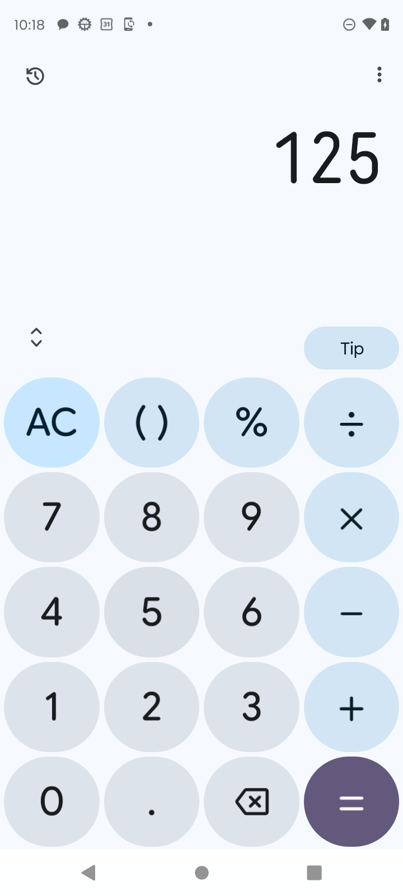
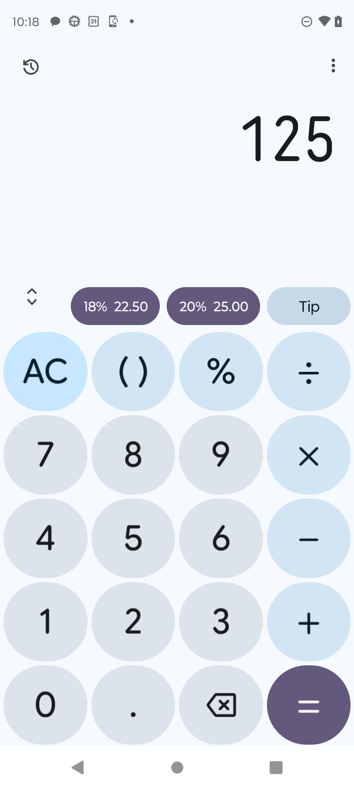
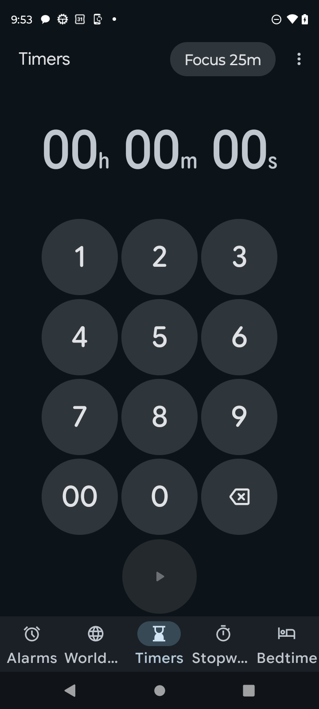

# App mods spike: "add a tip button to my calculator"

**Verdict: works on the phone, looks native, demo-ready for Calculator and Clock.** You say "add a tip button to my calculator" and a Tip key shows up in the Calculator **in about 0.1 to 0.5 s**, styled like the app's own keys. It reads the number on the display, offers 18% / 20%, and when you tap one, it presses the calculator's own `+`, digits and `=` keys. The app's code is never touched.

   

## How it works (plain words)

Think of it as a **sticky note placed on top of an app**, not a change to the app. Our app (`local.agentos.appmod`) is an accessibility service, the same kind of thing as a screen reader. It can:
1. **See** the app's layout: every button's id and position (e.g. Calculator's `÷` is `op_div` at x 543..713, y 674..835).
2. **Draw** a small window on top (an "accessibility overlay").
3. **Press** the app's own buttons (`ACTION_CLICK`, just like TalkBack does when you double-tap).

A mod is a small JSON **spec** that says *which app*, *where* (next to which button), *what it says*, and *what it does*. A model can write this at runtime. Examples are in `specs/`.

```json
{ "id": "tip", "package": "com.google.android.calculator", "label": "Tip",
  "anchor": {"id": "op_div"}, "place": "above", "gap": 8, "w": "anchor", "h": 44,
  "alt": [{"anchor": {"id": "collapse_expand"}, "place": "right", "gap": 16, "w": 96, "h": 44}],
  "style": {"sample": "op_div"},
  "action": { "type": "compute", "read": ["result_preview", "formula"],
              "chips": [{"label": "18%", "factor": 0.18}, {"label": "20%", "factor": 0.20}],
              "chipStyle": {"sample": "eq"}, "onChip": ["op_add", "$value", "eq"], "keys": {"0": "digit_0", "...": "..."} } }
```

| field | meaning |
|---|---|
| `anchor` | the app button to stick next to: `{"id": ...}` or `{"text": ...}`. A list means "try these in order" (apps have layout variants). |
| `place`, `align`, `gap`, `dx`, `dy`, `w`, `h` | `above / below / left / right / over` the anchor, sizes in dp, `"anchor"` = same size as the anchor. |
| `alt` | backup spots. A spot is rejected if it would **cover any of the app's own buttons** or go off-screen. If no spot is free, the mod hides. |
| `when` | only show while these nodes are on screen (e.g. the Clock's Start button, so it only shows on the timer setup page). |
| `style.sample` | **copy the look of this app button**: one screenshot gives the background color, text color and corner roundness. Or give `bg`/`fg`/`round` directly. |
| `action.type: "press"` | press this list of the app's buttons in order. |
| `action.type: "compute"` | read a number from the app's display, show result chips (`factor` × number), and on tap press `onChip`, where `$value` is typed with the `keys` map. |

Behaviour that comes for free:
- **Shows only while the app is in front**, hides on another tab, the home screen or the notification shade ([shot](shots/12-clock-other-tab-hidden.png), [shot](shots/13-home-no-mod.png)).
- **Follows layout changes**: it re-places on every window/content/scroll event (16 ms debounce). In landscape the calculator moves `÷` to the bottom row, so "above ÷" would cover `%`. The collision check rejects that spot and uses the `alt` spot next to `< >` ([shot](shots/04-calc-landscape.png)). Colors are re-sampled per orientation and theme.
- **Live values**: the tip chips recompute as you type.
- **Easy to remove**: long-press the mod ([shot](shots/06-calc-longpress-removed.png)), or `./mod.sh remove tip`. Mods persist across reboots (SharedPreferences) until removed.
- **Uses the app's font when it ships one** as a resource (Clock: Google Sans, read-only via `createPackageContext`). Calculator's fonts are download-only, so it falls back to system sans-serif-medium, which looks close.

## Timing (measured on the moto g 5G, logcat `AppMod`)

| step | time |
|---|---|
| apply → mod on screen, colors already sampled for this app/orientation | **58 to 82 ms** |
| apply → on screen, first time (one screenshot to sample colors) | **230 to 520 ms** (the screenshot itself is 50 to 280 ms) |
| Tip chip → calculator shows the total (5 key presses) | **78 to 96 ms** |
| "Focus 25m" → 25:00 timer running (11 key presses) | **318 ms** |
| `./mod.sh apply` from the Mac (adb + `am broadcast` start-up) | ~2.3 s (adb overhead; the broker would call it in-process) |

Add the model writing the spec. That's one short JSON answer, so "add a tip button" should land in ~2 to 4 s end to end with a fast model, and most of that is the model.

## Run it

```sh
cd spikes/app-mod
./build.sh                    # javac + d8 + aapt2, same recipe as android/build.sh
./mod.sh install              # adb install + allow restricted settings (Android 13 sideload rule)
./mod.sh enable               # appends our a11y service; keeps AgentOS's own (local.agentos/.AgentA11y)
./mod.sh apply specs/tip.json # prints {"ok":true,"id":"tip","shown":true,"ms":75}
./mod.sh apply specs/pomodoro.json
./mod.sh list                 # [{"id":"tip",...,"shown":true}]
./mod.sh remove tip
./mod.sh disable              # removes only our service again
```
`install`/`enable`/`disable` take `/tmp/agentos-device.lock`; set `LOCKED=1` if you already hold it. The command receiver is guarded by the `DUMP` permission, so only adb or system can send it. No app on the phone can inject a mod.

Demo script: open Calculator, type 125 → "add a tip button to my calculator" → Tip appears → tap Tip → tap 20% → display shows 150.

## The two mods

1. **Tip (Calculator, `com.google.android.calculator` 9.3).** Sits above `÷` in the empty strip next to the scientific toggle, same width and pill shape, color sampled from `÷` (#D2E5F4 on #0A1E28). The chips copy the purple `=` key. Best target: a big empty strip, stable ids (`op_div`, `digit_N`, `eq`, `formula`, `result_preview`), and the display text is readable.
2. **Focus 25m (Clock, `com.google.android.deskclock` 8.4).** In the Timers toolbar next to ⋮. Clears the entry, types 2-5-0-0 on the clock's keypad, and presses Start. It covers both Timers layouts I saw on this phone (preset-chip layout with `timer_start_button`, and keypad layout with `add_timer_button`; the bench's `pm clear` flips between them).

Camera (`com.motorola.camera3`) was not tried. It's a SurfaceView with few labelled nodes and is FLAG_SECURE-ish in places, so it's a poor first target.

## Gotchas found

- **A disabled key is not an error.** Backspace on an empty timer is disabled; `performAction` returns false. The mod skips it and only aborts if a button is *missing*.
- **Don't sample colors mid-animation.** The first sample can catch the app's launch or rotation. The sampler waits 400 ms after the app comes to front or rotates, and throws the shot away if the app left or the anchor moved.
- **`uiautomator dump` suspends all accessibility services** (ours and AgentOS's) while it runs. Don't use it during a demo.
- **Shared phone:** right after a rotation, something sent HOME as root (`START ... HOME ... from uid 0`) twice. The bench honors the lock, so it's something else. The Motorola OTA screen also pops up over apps. Both are worth a look before the demo.
- AgentOS's `Screen.java` skips accessibility-overlay windows, so **the agent and Prompt Guard don't see mods** (good: mods can't trip the guard or be read as app text). The "Suspicious text in Calculator" flags seen in the command center around 09:55 were not from this.

## Recommendation

**Put it in the demo, with the Calculator Tip as the hero.** It's the clearest "whoa": spoken request, ~0.3 s later a native-looking key, and tapping it drives the real app. Keep Clock "Focus 25m" as a second beat or backup. Wire it as a broker tool per `NEEDS.md` (the model writes the spec from a `screen.read`, the broker validates it, one tap approves, and it gets audited). Before stage: warm the color sample once (open Calculator with the mod applied) so the live apply is the 60 to 80 ms path, and pin the Clock layout (don't run the bench's `pm clear` right before).
